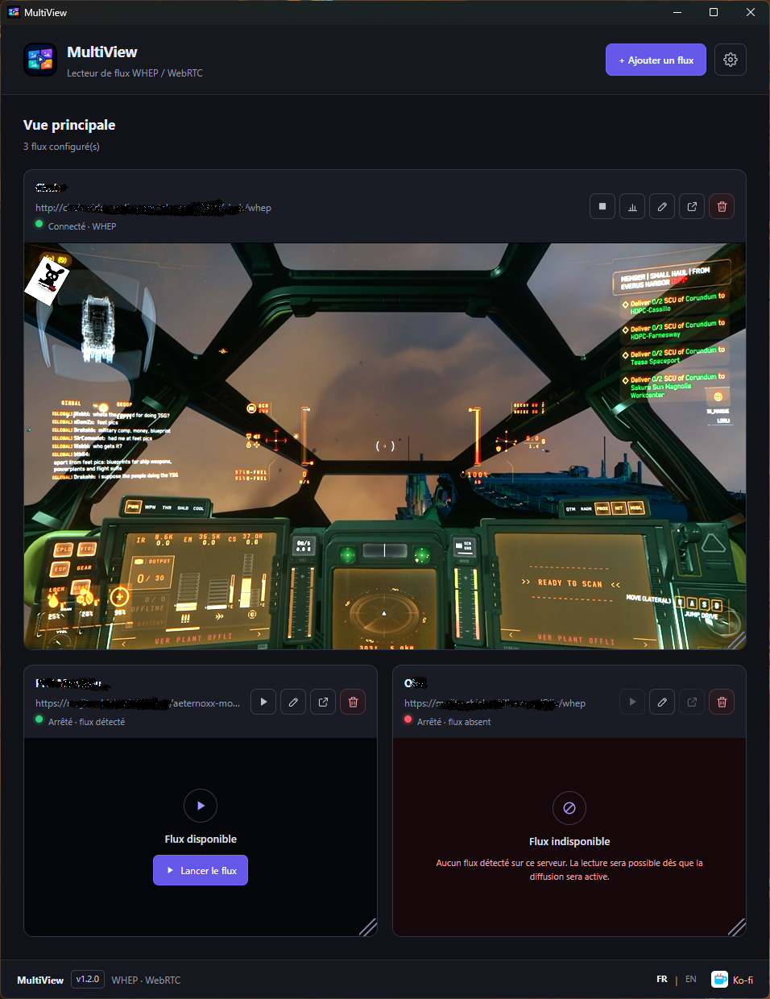

# MultiView

**MultiView lets you watch your friends' OBS streams while gaming, using floating video windows displayed over your game.**

Connect to your friends' **OBS streams shared through MediaMTX**, detach each stream into a floating window, and watch everyone's point of view simultaneously without leaving your game.

MultiView is a Windows desktop application built with Electron, React, and TypeScript. It supports WebRTC streams through WHEP.

## ✨ Features

- **Multiple streams** — Watch several friends' views simultaneously.
- **Floating windows** — Keep individual streams visible over your game.
- **Always on top** — Keep detached streams above other windows, with a pin toggle when you need it off.
- **Audio controls** — Adjust or mute each stream individually, with a solo mode.
- **Automatic recovery** — Streams reconnect on their own after a network drop or an OBS restart.
- **Live statistics** - Bitrate, FPS, resolution, jitter and dropped frames per stream.
- **Import / export** - Back up your stream list or share it with a friend.
- **Flexible viewing** — Resize windows, preserve aspect ratios, or switch to fullscreen.
- **Stream management** — Add, rename, remove, and reattach streams; reorder them by dragging.
- **Manual playback** — Start streams whenever you're ready, individually or all at once.
- **Local storage** — Your saved stream sources stay on your computer.

> **Note:** Some games running in exclusive fullscreen mode may appear above floating windows. Borderless fullscreen is recommended.

## Screenshots



## 📥 Download

**[Download the latest release](https://github.com/Aeternoxx/MultiView/releases/latest)**

Choose the Windows installer or the portable version, if available in the release.

## 🚀 Getting started

1. Make sure your friends are sharing their OBS streams through a compatible server, such as MediaMTX.
2. Open MultiView and add a stream using its WHEP URL.
3. Start playback.
4. Detach the stream into a floating window.
5. Repeat for each friend and enjoy watching everyone's view while you play!

Example WHEP endpoint:

`https://example.com/stream/whep`

The actual URL depends on the server configuration. The server must support WHEP and be reachable from your computer.

## 🛠️ Development

Requirements: Windows, [Node.js (LTS)](https://nodejs.org/) and npm.

```bash
git clone https://github.com/Aeternoxx/MultiView.git
cd MultiView
npm install
npm run dev
```

Useful commands:

| Command                | Description                           |
| ---------------------- | ------------------------------------- |
| `npm run dev`          | Start the app with hot reload         |
| `npm run build`        | Type-check and build the app          |
| `npm test`             | Run the unit tests (Vitest)           |
| `npm run typecheck`    | Type-check main, preload and renderer |
| `npm run lint`         | Run ESLint                            |
| `npm run format:check` | Check formatting with Prettier        |
| `npm run build:win`    | Build the Windows installers          |

## 🔒 Privacy

Saved stream sources are stored locally. Stream URLs may contain private information or access tokens, so remove sensitive data before sharing logs, screenshots, or bug reports.

The stream list (and the STUN/TURN settings, if you fill them in) is stored in the app's local storage on your machine. TURN credentials are only written to the local configuration file and are never sent anywhere else than to your own TURN server.

## 🤝 Contributing

Bug reports, suggestions, and contributions are welcome. Please include your MultiView version, Windows version, reproduction steps, and relevant logs. Remove private URLs and credentials before posting.

## ☕ Support the project

If you find MultiView useful, you can help support its development with an optional donation.

**[☕ Support MultiView on Ko-fi](https://ko-fi.com/aeternoxx)**

## 📄 License

No license has been specified yet. Until one is added, the code should not be assumed to be available for unrestricted use, modification, or redistribution.

---

# MultiView (Français)

**MultiView permet d'afficher les flux OBS de tes amis dans des fenêtres flottantes par-dessus ton jeu.**

Connecte-toi aux **flux OBS de tes amis diffusés via MediaMTX**, détache chaque flux dans une fenêtre indépendante et regarde leurs différents points de vue simultanément, sans quitter ton jeu.

MultiView est une application Windows développée avec Electron, React et TypeScript. Elle prend en charge les flux WebRTC via WHEP.

## ✨ Fonctionnalités

- **Flux multiples** — Regarde simultanément les vues de plusieurs amis.
- **Fenêtres flottantes** — Garde les flux visibles par-dessus ton jeu.
- **Toujours au premier plan** — Maintiens les fenêtres détachées au-dessus des autres applications, avec une épingle pour désactiver le mode si besoin.
- **Contrôle audio** — Règle ou coupe le son de chaque flux indépendamment, avec un mode solo.
- **Reconnexion automatique** — Les flux se reconnectent seuls après une coupure réseau ou un redémarrage d'OBS.
- **Statistiques en direct** — Débit, images/s, résolution, gigue et images perdues pour chaque flux.
- **Import / export** — Sauvegarde ta liste de flux ou partage-la avec un ami.
- **Affichage flexible** — Redimensionne les fenêtres, conserve les proportions ou passe en plein écran.
- **Gestion des flux** — Ajoute, renomme, supprime et réintègre les flux ; réordonne-les par glisser-déposer.
- **Lecture manuelle** — Lance les flux quand tu le souhaites, individuellement ou tous à la fois.
- **Stockage local** — Les sources enregistrées restent sur ton ordinateur.

> **À noter :** Certains jeux en plein écran exclusif peuvent passer devant les fenêtres flottantes. Le mode plein écran sans bordure est recommandé.

## Screenshots


## 📥 Téléchargement

**[Télécharger la dernière version](https://github.com/Aeternoxx/MultiView/releases/latest)**

Choisis l'installateur Windows ou la version portable, si elle est disponible dans la release.

## 🚀 Prise en main

1. Assure-toi que tes amis diffusent leurs flux OBS via un serveur compatible, comme MediaMTX.
2. Ouvre MultiView et ajoute un flux avec son URL WHEP.
3. Lance la lecture.
4. Détache le flux dans une fenêtre flottante.
5. Répète l'opération pour chaque ami et profite de leurs différents points de vue pendant que tu joues !

Exemple d'endpoint WHEP :

`https://example.com/stream/whep`

L'URL exacte dépend de la configuration du serveur. Celui-ci doit prendre en charge WHEP et être accessible depuis ton ordinateur.

## 🛠️ Développement

Prérequis : Windows, [Node.js (LTS)](https://nodejs.org/) et npm.

```bash
git clone https://github.com/Aeternoxx/MultiView.git
cd MultiView
npm install
npm run dev
```

Commandes utiles :

| Commande               | Description                                          |
| ---------------------- | ---------------------------------------------------- |
| `npm run dev`          | Lance l'application avec rechargement à chaud        |
| `npm run build`        | Vérifie les types et compile l'application           |
| `npm test`             | Lance les tests unitaires (Vitest)                   |
| `npm run typecheck`    | Vérifie les types du main, du preload et du renderer |
| `npm run lint`         | Lance ESLint                                         |
| `npm run format:check` | Vérifie le formatage avec Prettier                   |
| `npm run build:win`    | Génère les installateurs Windows                     |

## 🔒 Confidentialité

Les sources enregistrées sont stockées localement. Les URL des flux peuvent contenir des informations privées ou des jetons d'accès : pense à les retirer des journaux, captures d'écran et rapports de bugs que tu partages.

La liste des flux (ainsi que les paramètres STUN/TURN, si tu les renseignes) est stockée dans le stockage local de l'application, sur ta machine. Les identifiants TURN ne sont écrits que dans le fichier de configuration local et ne sont transmis qu'à ton propre serveur TURN.

## 🤝 Contributions

Les signalements de bugs, suggestions et contributions sont les bienvenus. Indique la version de MultiView, ta version de Windows, les étapes pour reproduire le problème et les journaux utiles. Retire les URL privées et les identifiants avant de publier.

## ☕ Soutenir le projet

Si MultiView te plaît, tu peux soutenir son développement avec un don facultatif.

**[☕ Soutenir MultiView sur Ko-fi](https://ko-fi.com/aeternoxx)**

## 📄 Licence

Aucune licence n'a encore été spécifiée. Tant qu'une licence n'est pas ajoutée, le code ne doit pas être considéré comme librement réutilisable, modifiable ou redistribuable.
