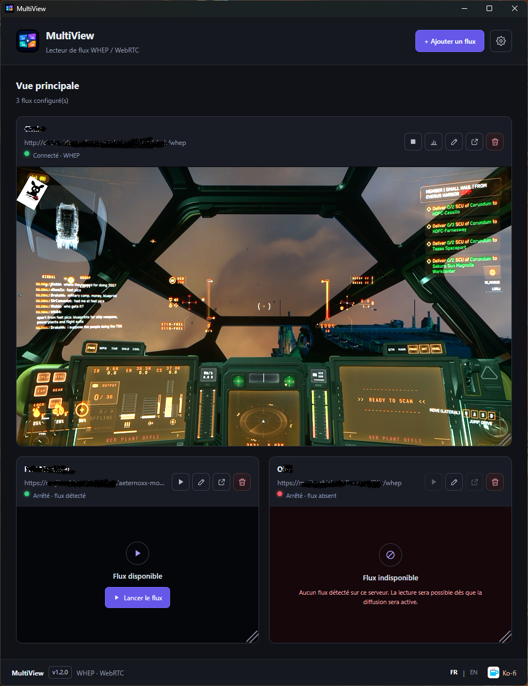

# MultiView

**MultiView shows your friends' OBS streams in floating windows over your game.** Connect to the streams they share through a WHEP-compatible server such as MediaMTX, detach each into its own window, and watch everyone's point of view while you play. A Windows app built with Electron, React and TypeScript.

> **Note:** Some games running in exclusive fullscreen appear above floating windows — a Windows limitation no application can work around. Borderless fullscreen is recommended; some anti-cheat protected games (Valorant/Vanguard for instance) block third-party overlays by design.

## ✨ Features

- **Multiple streams** — watch several friends' views at once, in the Live grid or launched directly as floating windows.
- **Floating windows** — detach any stream above your game, pin it on top, resize it, fullscreen it, return it to the app later.
- **Game-safe overlay** — pinned windows turn click-through as soon as another application (a game) owns the focus, so mouse and keyboard stay with the game.
- **Audio and statistics** — adjust, mute or solo each stream; watch bitrate, FPS, resolution, jitter and dropped frames.
- **Automatic recovery** — dropped streams retry for up to 5 minutes (network drop, OBS restart), then go back to the stopped state.
- **Library** — add, rename, remove and drag-reorder streams; select all, refresh availability, import and export.
- **Built-in updates** — new releases download in the background and install only when you say so.



## 📥 Download

**[Download the latest release](https://github.com/Aeternoxx/MultiView/releases/latest)** — `MultiView-<version>-setup.exe` installs for your user only, with no administrator rights. Later versions then arrive on their own: downloaded in the background, installed on one click on the update pill.

## 🚀 Getting started

1. Your friends share their OBS streams through a WHEP-compatible server, such as MediaMTX.
2. Add each stream by its WHEP URL — `https://example.com/stream/whep`, the exact shape depends on the server — and start playback.
3. Detach the streams into floating windows, pin them, and play.

### Low latency tips

MultiView already asks for the smallest possible playout buffer and only raises it when the measured jitter stays high; the current buffer delay shows in the **Statistics** panel. The rest comes mostly from the encoder:

- **OBS, x264:** `tune=zerolatency`, B-frames `0`, keyframe interval `1 s`, `scenecut=0`, CBR.
- **OBS, NVENC:** low-latency preset, look-ahead off, B-frames `0`.
- **Audio:** Opus 48 kHz, 20 ms frames, FEC on, DTX off.
- **Network:** skip the TURN relay when the server is on the same network.

## 🛠️ Development

Requirements: Windows, [Node.js (LTS)](https://nodejs.org/) and npm.

```bash
git clone https://github.com/Aeternoxx/MultiView.git
cd MultiView
npm install
npm run dev
```

| Command                | Description                           |
| ---------------------- | ------------------------------------- |
| `npm run dev`          | Start the app with hot reload         |
| `npm run build`        | Type-check and build the app          |
| `npm test`             | Run the unit tests (Vitest)           |
| `npm run typecheck`    | Type-check main, preload and renderer |
| `npm run lint`         | Run ESLint                            |
| `npm run format:check` | Check formatting with Prettier        |
| `npm run build:win`    | Build the Windows installer           |

### Releasing

1. Bump `version` in `package.json`, then write the notes as `docs/release-notes/v<version>.md` (copy `TEMPLATE.md`): that file is what the release page shows.
2. Commit as `Release v<version>: <summary>`, then push and tag:

   ```bash
   git push origin main
   git tag v<version>
   git push origin v<version>
   ```

The tag runs the Release workflow: it builds and publishes the installer with its blockmap and `latest.yml`, posts the notes, and trims every release but the three newest to their tags — installers are huge and the updater only reads the newest anyway. Installed copies see the new version within six hours and wait for one click to install it.

## 🔒 Privacy

Stream sources and the STUN/TURN settings you fill in stay in local storage on your machine, and TURN credentials are only ever sent to your own TURN server. Stream URLs may embed access tokens: strip them from logs, screenshots and bug reports.

## 🤝 Contributing & ☕ Support

Bug reports and suggestions are welcome — include your MultiView and Windows versions, reproduction steps and useful logs, with private URLs stripped. If MultiView pleases you, **[support it on Ko-fi](https://ko-fi.com/aeternoxx)**.

## 📄 License

No license has been specified yet; the code is not free to reuse, modify or redistribute until one is added.

---

# MultiView (Français)

**MultiView affiche les flux OBS de tes amis dans des fenêtres flottantes par-dessus ton jeu.** Connecte-toi aux flux qu'ils diffusent via un serveur compatible WHEP, comme MediaMTX, détache chacun dans sa fenêtre et regarde tous les points de vue pendant que tu joues. Une application Windows développée avec Electron, React et TypeScript.

> **À noter :** Certains jeux en plein écran exclusif passent devant les fenêtres flottantes — une limite de Windows qu'aucune application ne peut contourner. Le plein écran sans bordure est recommandé ; certains jeux protégés par un anti-cheat (Valorant/Vanguard par exemple) bloquent aussi les overlays tiers par conception.

## ✨ Fonctionnalités

- **Flux multiples** — regarde les vues de plusieurs amis à la fois, dans la grille Live ou lancées directement en fenêtres flottantes.
- **Fenêtres flottantes** — détache n'importe quel flux par-dessus ton jeu, épingle-le au premier plan, redimensionne-le, passe en plein écran, ou le remets dans l'application.
- **Overlay compatible jeu** — les fenêtres épinglées deviennent transparentes aux clics dès qu'une autre application (un jeu) a le focus : la souris et le clavier restent au jeu.
- **Audio et statistiques** — règle, coupe ou mets en solo chaque flux ; débit, images/s, résolution, gigue et images perdues en direct.
- **Reconnexion automatique** — un flux coupé se reconnecte pendant jusqu'à 5 minutes (coupure réseau, redémarrage d'OBS), puis repasse à l'état arrêté.
- **Bibliothèque** — ajoute, renomme, supprime et réordonne tes flux par glisser-déposer ; tout cocher, actualiser la disponibilité, importer et exporter.
- **Mises à jour intégrées** — les nouvelles versions se téléchargent en arrière-plan et ne s'installent que sur ton feu vert.


## 📥 Téléchargement

**[Télécharger la dernière version](https://github.com/Aeternoxx/MultiView/releases/latest)** — `MultiView-<version>-setup.exe` s'installe pour ton utilisateur uniquement, sans droits administrateur. Les versions suivantes arrivent ensuite toutes seules : téléchargées en arrière-plan, installées en un clic sur la pastille de mise à jour.

## 🚀 Prise en main

1. Tes amis diffusent leurs flux OBS via un serveur compatible WHEP, comme MediaMTX.
2. Ajoute chaque flux avec son URL WHEP — `https://example.com/stream/whep`, la forme exacte dépend du serveur — et lance la lecture.
3. Détache les flux en fenêtres flottantes, épingle-les, et joue.

### Conseils faible latence

MultiView demande déjà le plus petit tampon de lecture possible et ne l'augmente que si la gigue mesurée reste élevée ; la latence du tampon s'affiche dans le panneau **Statistiques**. Le reste vient surtout de l'encodeur :

- **OBS, x264 :** `tune=zerolatency`, B-frames `0`, images clés toutes les `1 s`, `scenecut=0`, CBR.
- **OBS, NVENC :** preset faible latence, look-ahead désactivé, B-frames `0`.
- **Audio :** Opus 48 kHz, trames de 20 ms, FEC activé, DTX désactivé.
- **Réseau :** évite le relais TURN quand le serveur est sur le même réseau.

## 🛠️ Développement

Prérequis : Windows, [Node.js (LTS)](https://nodejs.org/) et npm.

```bash
git clone https://github.com/Aeternoxx/MultiView.git
cd MultiView
npm install
npm run dev
```

| Commande               | Description                                          |
| ---------------------- | ---------------------------------------------------- |
| `npm run dev`          | Lance l'application avec rechargement à chaud        |
| `npm run build`        | Vérifie les types et compile l'application           |
| `npm test`             | Lance les tests unitaires (Vitest)                   |
| `npm run typecheck`    | Vérifie les types du main, du preload et du renderer |
| `npm run lint`         | Lance ESLint                                         |
| `npm run format:check` | Vérifie le formatage avec Prettier                   |
| `npm run build:win`    | Génère l'installeur Windows                          |

### Publier une version

1. Augmente `version` dans `package.json`, puis écris les notes dans `docs/release-notes/v<version>.md` (copie `TEMPLATE.md`) : c'est ce fichier qui s'affiche sur la page de la release.
2. Committe en `Release v<version> : <résumé>`, puis pousse et tague :

   ```bash
   git push origin main
   git tag v<version>
   git push origin v<version>
   ```

Le tag déclenche le workflow Release : il compile et publie l'installeur avec son blockmap et `latest.yml`, dépose les notes, et ne garde que les trois releases les plus récentes — les installeurs sont énormes et l'updater ne lit que la dernière. Les copies installées voient la nouvelle version sous six heures et attendent un clic pour l'installer.

## 🔒 Confidentialité

Les sources de flux et les réglages STUN/TURN restent dans le stockage local de ta machine, et les identifiants TURN ne sont transmis qu'à ton propre serveur TURN. Les URL de flux peuvent contenir des jetons d'accès : retire-les des journaux, captures et rapports de bug.

## 🤝 Contributions & ☕ Soutien

Les signalements de bugs et suggestions sont les bienvenus — indique tes versions de MultiView et de Windows, les étapes de reproduction et les journaux utiles, sans URL privée. Si MultiView te plaît, **[soutiens-le sur Ko-fi](https://ko-fi.com/aeternoxx)**.

## 📄 Licence

Aucune licence n'a encore été spécifiée ; le code n'est pas librement réutilisable, modifiable ou redistribuable tant qu'une licence n'est pas ajoutée.
